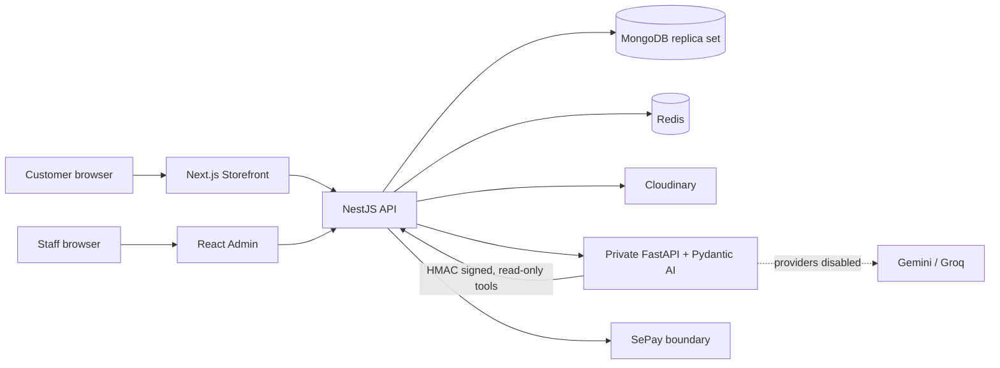

# FARTA Commerce

Production-oriented fashion commerce platform built as a TypeScript/Python monorepo. FARTA combines
a premium Next.js storefront, an operational React admin, a security-focused NestJS commerce API,
and a private Pydantic AI Product Advisor that can access only allowlisted public catalog tools.

> **Release status:** staging candidate. Core commerce and automated release gates are implemented;
> production payment-provider delivery, OAuth, transactional email, alerting and production-scale
> capacity are not yet validated. The Product Advisor source is deployed, but live providers remain
> disabled: Gemini failed the third Phase 6B flow; Groq model access was later verified, but the
> first public flow in Campaigns 02 and 03 failed closed with `AI_LIMIT_EXCEEDED`. Campaign 04 then
> passed grounded product search but failed its availability flow with
> `AI_OUTPUT_UNVERIFIED_CLAIM`. The canary stopped at 5/7 provider requests and staging was rolled
> back to provider-off; no live provider has passed the required three consecutive flows.

## Live staging

- Storefront: <https://staging.fartacommerce.me>
- Admin: <https://admin-staging.fartacommerce.me>
- API health: <https://api-staging.fartacommerce.me/api/v1/health/live>

Staging is intentionally `noindex`. Test credentials and secrets are never stored in this repository.

## Engineering highlights

- Server-authoritative catalog, variants, integer-VND pricing, inventory ledger and semantic stock
  availability.
- Guest and customer carts with ownership isolation, bounded cart merge and CSRF-protected
  mutations.
- Atomic checkout with price/stock revalidation, inventory reservations, immutable order snapshots,
  idempotency and COD state separation.
- Provider-neutral payment records, authenticated SePay-shaped webhook boundary, replay protection,
  amount verification and explicit reconciliation conflicts.
- Permission-based Admin catalog/order operations with audit trails and valid state transitions.
- Premium responsive Storefront with Cloudinary media, product variants, filters, search, account and
  order journeys.
- Private FastAPI/Pydantic AI Product Advisor with typed tool calls, structured output validation,
  bounded execution and authoritative NestJS re-hydration.
- Cloudflare-hosted frontends and custom domains; NestJS/FastAPI services run on Northflank with
  managed MongoDB/Redis boundaries.

## Architecture



The LLM is never a commerce authority. It has no database credentials and cannot mutate Cart,
Order, Payment, Inventory, Account or Admin state. Every Product Advisor tool call returns through
the authenticated NestJS Tool Gateway, and NestJS re-hydrates all model-selected product slugs
before sending data to the browser.

## Applications and stack

| Workspace                | Responsibility                                  | Main technology                        |
| ------------------------ | ----------------------------------------------- | -------------------------------------- |
| `apps/storefront`        | Customer shopping experience                    | Next.js 16, React 19, Tailwind CSS 4   |
| `apps/admin`             | Catalog, inventory, banner and order operations | React 19, Vite 8, TanStack Query       |
| `apps/api`               | Auth and authoritative commerce domains         | NestJS 12, Mongoose 9, Redis           |
| `apps/ai-service`        | Read-only Product Advisor                       | FastAPI, Pydantic AI 2.57, Gemini/Groq |
| `packages/ui`            | Shared accessible primitives                    | React, TypeScript                      |
| `packages/design-tokens` | Semantic design tokens                          | CSS/TypeScript                         |
| `packages/types`         | Shared public contracts                         | TypeScript                             |

Runtime baseline: Node.js `22.23.2`, pnpm `10.34.3`, TypeScript `5.9.3`, Python
`>=3.12,<3.15`. Exact dependency versions are pinned in the lockfiles.

## Implemented domains

### Identity and security

- Customer/staff realm separation, JWT access sessions and refresh rotation.
- HttpOnly cookies, exact-origin CORS, CSRF protection and deployed HTTPS policy.
- Granular permissions, object ownership checks, rate limits and redacted structured logs.
- Explicit DTO allowlists and rejection of unknown/mass-assignment fields.

### Catalog and media

- Category hierarchy, Products, ProductVariants, unique slugs/SKUs and publication invariants.
- Cloudinary-backed images/video metadata with controlled upload/finalization and reference safety.
- Banner scheduling, safe internal CTA validation, public filters/search/sort and bounded pagination.
- Append-oriented inventory transactions and atomic/idempotent adjustments.

### Transactional commerce

- Guest/authenticated Cart and deterministic ownership-safe merge.
- Checkout preview and submission with server-side repricing and stock revalidation.
- Atomic Reservations, inventory ledger updates, Order snapshots and Payment records.
- COD, deposit/full-payment states, guest order lookup and customer order history.
- Admin fulfillment/cancellation, reconciliation, reservation expiry and notification outbox.

### Product Advisor

The supported execution path is:

```text
Deterministic scope router
  -> Pydantic AI Agent
  -> typed allowlisted catalog tool
  -> authenticated NestJS Tool Gateway
  -> validated structured response
  -> NestJS product re-hydration
```

Agent limits are fail-closed and provider-campaign specific. The Groq canary configuration permits
at most two model iterations, one tool execution, 768 output tokens per model request (1536
cumulative across the two-request run), a 25-second model timeout and a 60-second Agent timeout. A
Redis counter claims before each outbound Groq HTTP request and
rejects requests beyond the explicit canary ceiling. Automatic provider fallback and retries are
disabled.
The model cannot answer supported catalog requests from router templates; it must use live Agent
execution and authoritative tool observations. See [AI API contract](docs/api/ai-agent.md) and
[evaluation methodology](docs/ai/evaluation-methodology.md).

The staging providers are currently **off**. Two public Gemini Agent flows succeeded during Phase
6B, but the third exhausted the Agent request budget. Phase 6C added an independent Redis ceiling.
After correcting the namespaced metadata lookup, exact Groq model access passed. Campaign 02 found
and corrected cumulative output-token accounting, while Campaign 03 exposed a final-output
contract problem. Campaign 04 validated the strict two-phase execution far enough for grounded
product search to complete: one `search_products` call, two model requests and one NestJS
re-hydrated product. Its second flow executed authoritative `get_product_availability` but the final
answer was rejected as `AI_OUTPUT_UNVERIFIED_CLAIM`; execution stopped at exactly 5/7 Groq HTTP
requests and rollback restored provider-off. Provider-off requests fail safely with
`AI_PROVIDER_DISABLED` while ordinary catalog browsing continues to work.

## Run locally

### Prerequisites

- Node.js version from `.nvmrc`
- pnpm through Corepack
- Python 3.12–3.14 and `uv`
- Docker Desktop for the local MongoDB replica set and Redis

### Commerce applications

```bash
corepack enable
pnpm install --frozen-lockfile

cp .env.example apps/api/.env
cp apps/storefront/.env.example apps/storefront/.env.local
cp apps/admin/.env.example apps/admin/.env.local

pnpm infra:up
pnpm dev
```

Default local endpoints:

- Storefront: `http://localhost:3000`
- API: `http://localhost:4000`
- Admin: `http://localhost:5173`
- AI service: `http://localhost:8000`

### AI service

```bash
cd apps/ai-service
uv sync --frozen
uv run uvicorn app.main:app --reload --port 8000
```

The AI boundary is disabled by default. Generate independent gateway/tool/conversation secrets and
configure them only in ignored local env files or a deployment secret manager. Never expose provider
keys through `NEXT_PUBLIC_*` or `VITE_*`.

### Development catalog

The seed is development-only and refuses staging/production. It requires finalized development
media and an existing local OWNER identity; it never creates a default password.

```bash
pnpm --filter @farta/api seed:development
```

See [development seed report](docs/phase-4/development-seed-report.md) for the media manifest and
idempotency rules.

## Quality gates

```bash
pnpm install --frozen-lockfile
pnpm format:check
pnpm lint
pnpm typecheck
pnpm test
pnpm test:e2e
pnpm build
pnpm audit:prod

cd apps/ai-service
uv sync --frozen
uv run ruff format --check .
uv run ruff check .
uv run pytest
uv run python -m app.evaluation.agent_eval
```

The versioned Vietnamese Product Advisor evaluation contains 62 cases across search, detail,
availability, styling, ambiguity, adversarial input, provider/tool failure and multi-turn context.
It checks routing/tool policy without spending provider quota; live-provider evidence is reported
separately.

Browser coverage uses Playwright `1.64.0` and supports Chromium, Firefox and WebKit. Local execution
requires the approved development media seed and test-only staff credentials supplied through the
process environment.

```bash
pnpm test:browser:install
E2E_STAFF_EMAIL=<development-staff-email> \
E2E_STAFF_PASSWORD=<development-staff-password> \
pnpm test:browser
```

## Security and correctness invariants

- Money is integer VND and always recalculated by the server.
- Public APIs expose semantic availability, not internal warehouse quantity.
- Inventory mutation and its ledger entry share a short MongoDB transaction.
- Checkout idempotency binds owner, operation, request hash and logical result.
- Payment redirects are informational; authenticated webhook/provider verification is authoritative.
- Duplicate checkout/webhook/worker delivery must have one effective result.
- Product, banner and Agent content is rendered as plain data, never unsanitized HTML.
- Secrets are excluded from Git, public client bundles, logs, reports and test artifacts.

Architecture decisions live under [`docs/adr`](docs/adr/), API contracts under
[`docs/api`](docs/api/) and phase evidence under [`docs/phase-1`](docs/phase-1/) through
[`docs/phase-6`](docs/phase-6/).

## Deployment boundary

- Storefront/Admin: Cloudflare Workers with custom staging domains.
- API/private AI service: Northflank.
- Data: managed MongoDB replica set and Redis.
- Media: Cloudinary.

Source presence, local tests and successful builds do not prove production readiness. Current
reports deliberately separate local evidence, CI, deployed runtime, external-provider tests and
unverified operational controls. Start with the
[Phase 6 live Agent closure](docs/phase-6/live-agent-release-closure.md) and
[Groq canary report](docs/phase-6/groq-live-canary.md) for the latest status.

## CV-ready summary

> Built a production-oriented fashion commerce monorepo with Next.js, React, NestJS, MongoDB,
> Redis and FastAPI/Pydantic AI. Implemented server-authoritative catalog/inventory, idempotent
> checkout and reservations, immutable orders, payment/webhook reconciliation, RBAC Admin
> operations, responsive storefront release tests, and a security-bounded read-only Product
> Advisor that grounds model output through authenticated commerce tools.

## Known limitations

- Staging approval does not imply production readiness or validated production capacity.
- Real SePay Test-mode delivery, OAuth, transactional email and monitoring alerts remain external
  provider work until evidence is recorded.
- AI service horizontal scaling remains limited to one replica while inbound replay claims are
  process-local.
- Live Product Advisor release remains blocked until a newly approved, exactly metered canary proves
  three consecutive grounded public flows with the iteration guard.
- No RAG, LangGraph, AI commerce mutations, autonomous refunds, Wishlist, Reviews, Coupons or
  Loyalty are included in the current scope.

## License

No open-source license is currently included. All rights remain with the repository owner unless a
license is added explicitly.
