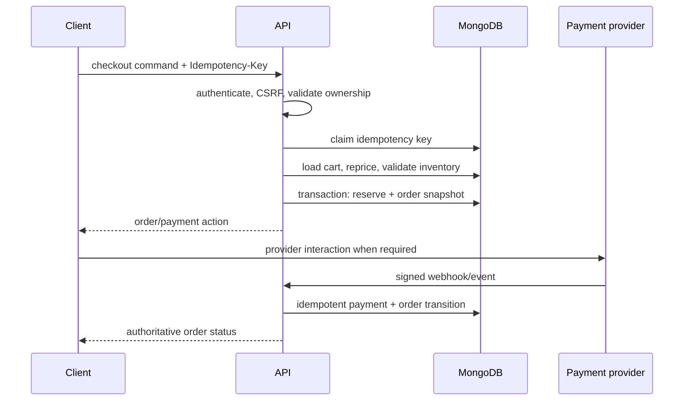
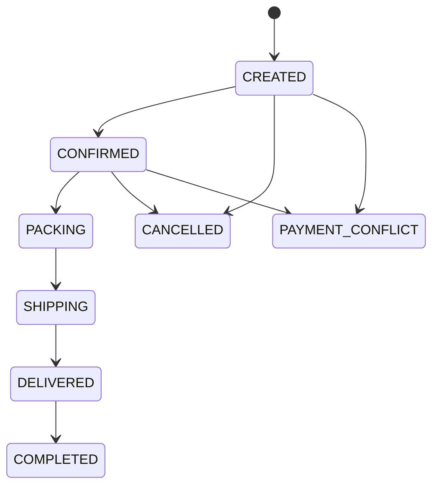

# Checkout and order architecture

## Checkout orchestration

An idempotency record binds realm, actor/cart, route, key and canonical request hash. Reusing a key with a different request is rejected.

## Order snapshot

Each `OrderItem` stores `productId`, `variantId`, product name, SKU, color, size, unit price, quantity, discount/tax allocation where applicable, currency and image snapshot metadata. Shipping/customer contact snapshots are separated from mutable profiles and retained according to privacy policy.

## Fulfillment state machine

Transition commands declare allowed source states, permission, side effects and audit event. Arbitrary `status` updates are forbidden.

## Payment state machine

`UNPAID → DEPOSIT_PAID → FULLY_PAID` where the selected method supports deposits.  
`DEPOSIT_PAID|FULLY_PAID → REFUND_PENDING → REFUNDED`.  
Any verified amount/reference mismatch enters `PAYMENT_CONFLICT` for review.

The frontend never declares payment success. Only verified provider callbacks or explicit server-side provider verification can transition payment state.

## Failure recovery

- Transaction failure creates no partial order/reservation.
- Provider timeout leaves a queryable pending state; retries use the same idempotency key.
- Webhooks validate signature, timestamp/replay rules, provider event ID, order reference, amount and currency before transition.
