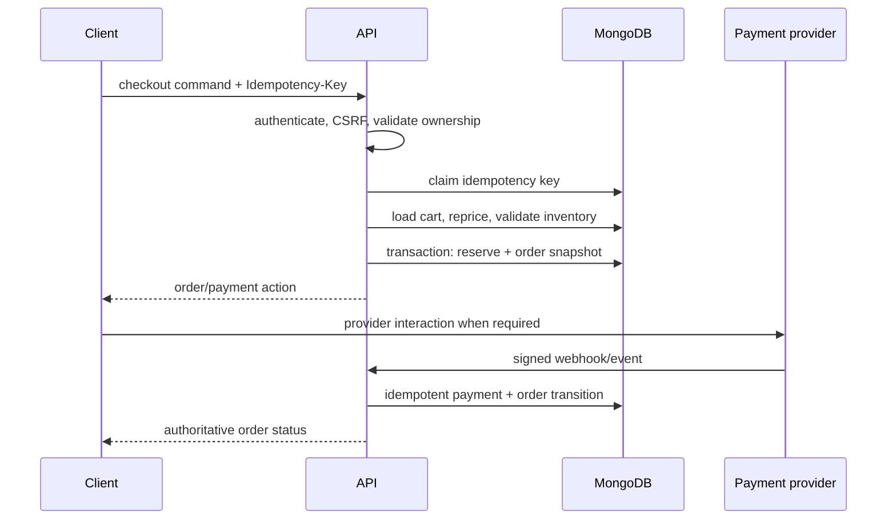
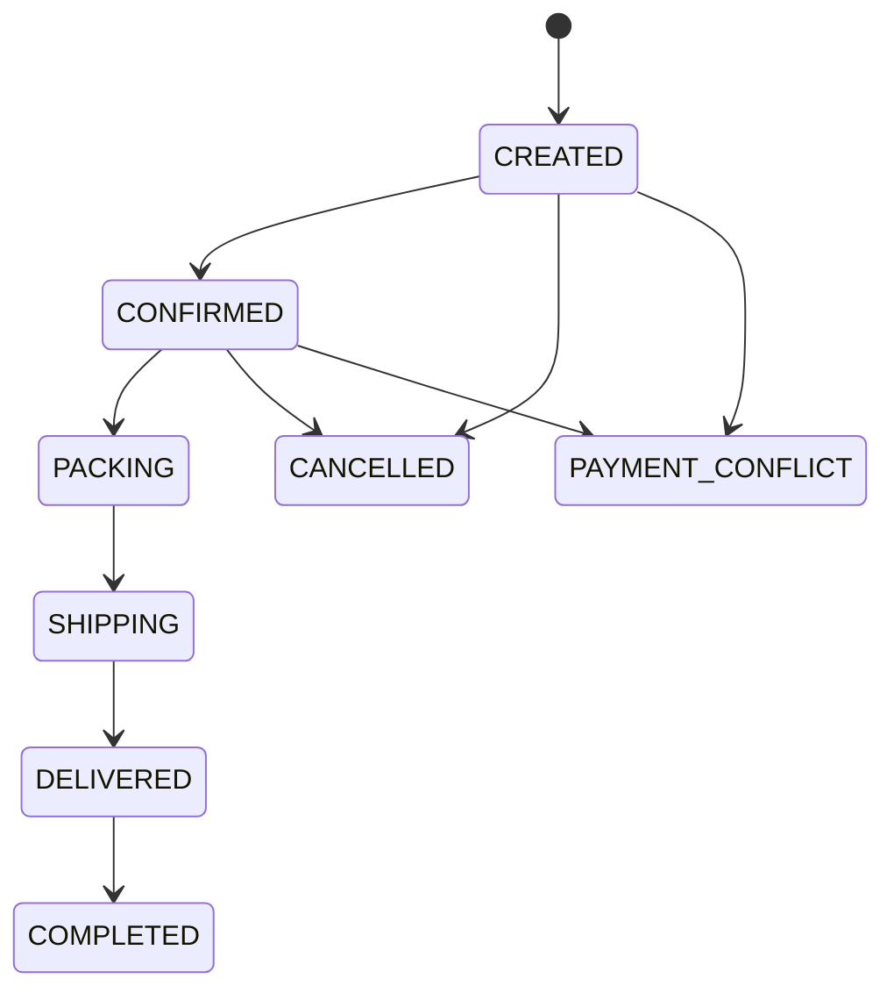

# Checkout and order architecture

## Checkout orchestration

An idempotency record binds realm, actor/cart, route, key and canonical request hash. Reusing a key with a different request is rejected.

## Implementation boundary

The implemented modules are `IdempotencyModule`, `ReservationsModule`, `CheckoutModule`, `OrdersModule` and the provider-neutral `PaymentsModule`. `CartService.loadForCheckout()` reloads the owned cart inside the caller's MongoDB session. `InventoryService.reserveBatch()` performs conditional inventory updates and append-only ledger writes in that same session; the standalone Phase 2 reservation proof is not called by checkout.

The atomic commit contains:

1. idempotency claim;
2. authoritative cart/catalog/price reload;
3. active reservation rows and conditional inventory increments;
4. immutable order/shipping snapshots;
5. an `UNPAID` provider-neutral COD or SePay payment;
6. confirmed COD reservations or active online-payment reservations;
7. converted cart and completed idempotency result.

Preview does not reserve. The preview quote is an HMAC over current server-calculated content, so a price or cart change produces `CHECKOUT_QUOTE_CHANGED` before allocation.

## Order snapshot

Each `OrderItem` stores `productId`, `variantId`, product name, SKU, color, size, unit price, quantity, discount/tax allocation where applicable, currency and image snapshot metadata. Shipping/customer contact snapshots are separated from mutable profiles and retained according to privacy policy.

## Fulfillment state machine

Transition commands declare allowed source states, permission, side effects and audit event. Arbitrary `status` updates are forbidden.

## Payment state machine

`UNPAID → DEPOSIT_PAID → FULLY_PAID` where the selected method supports deposits.  
`DEPOSIT_PAID|FULLY_PAID → REFUND_PENDING → REFUNDED`.  
Any verified amount/reference mismatch enters `PAYMENT_CONFLICT` for review.

The frontend never declares payment success. Only verified provider callbacks or explicit server-side provider verification can transition payment state.

## SePay receipt boundary

The adapter creates an official VietQR delivery URL from server-side bank configuration and the persisted payment reference. It verifies SePay's `sha256=HMAC_SHA256(secret, timestamp + "." + rawBody)` header using the original body bytes and constant-time comparison. Timestamp tolerance is configurable and capped by schema validation. Provider event `id` is uniquely claimed before any payment transition.

The official bank-webhook payload is VND-only and has no independent currency field. FARTA normalizes it to `VND` and compares it to the immutable payment currency. Duplicate/concurrent events have one effective transition; amount, account, expired-window or incompatible-state events produce explicit conflict records.

## Failure recovery

- Transaction failure creates no partial order/reservation.
- Instruction retry reuses the persisted payment/reference and cannot create another payment.
- Webhooks validate signature, timestamp/replay rules, provider event ID, order reference, amount and currency before transition.

## Fulfillment, sale and cancellation transactions

Admin fulfillment commands never update arbitrary fields. They load order/payment state inside a short transaction, apply the order and payment policies, then persist the transition, inventory side effects, audit record and notification intent together.

- `PACKING → SHIPPING` converts every confirmed order reservation to authoritative inventory consumption: `onHand -= quantity`, `reserved -= quantity`, followed by an append-only `SALE` ledger row.
- Eligible cancellation releases `ACTIVE` or `CONFIRMED` allocations and marks their reservations `CANCELLED` in the same transaction.
- A confirmed reservation remains the historical allocation record after sale; the `SALE` ledger and order `SHIPPING` state prove consumption. It is never eligible for cancellation after shipping.
- COD selection stays `UNPAID`. Only the delivered/completed staff command records `codCollectedAt`, `codCollectedBy`, server-owned amount and `FULLY_PAID`.

## Reservation expiry worker

`pnpm --filter @farta/api worker:reservations` runs a separate bounded polling process. Each candidate is reloaded with `status=ACTIVE` and due `expiresAt` inside its own transaction. Release, ledger and `EXPIRED` state commit together. A second worker finds no eligible state and becomes a no-op. The transaction callback's local metric marker is reset on driver retry, so transient transaction retries do not inflate the released count.

No BullMQ dependency was added. Production must supervise this process separately from the API. Interval and batch size come from `RESERVATION_WORKER_INTERVAL_MS` and `RESERVATION_WORKER_BATCH_SIZE`.

## Notification outbox

Order-created, payment-received, confirmed, shipped and delivered actions insert an idempotent `PENDING` event within the business transaction. Payloads contain only order code and status metadata. Deposit and final-payment receipts have distinct semantic keys. No email/provider adapter exists yet, so the system does not claim delivery.
