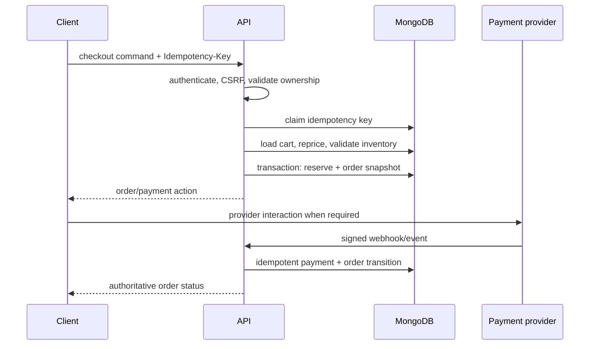
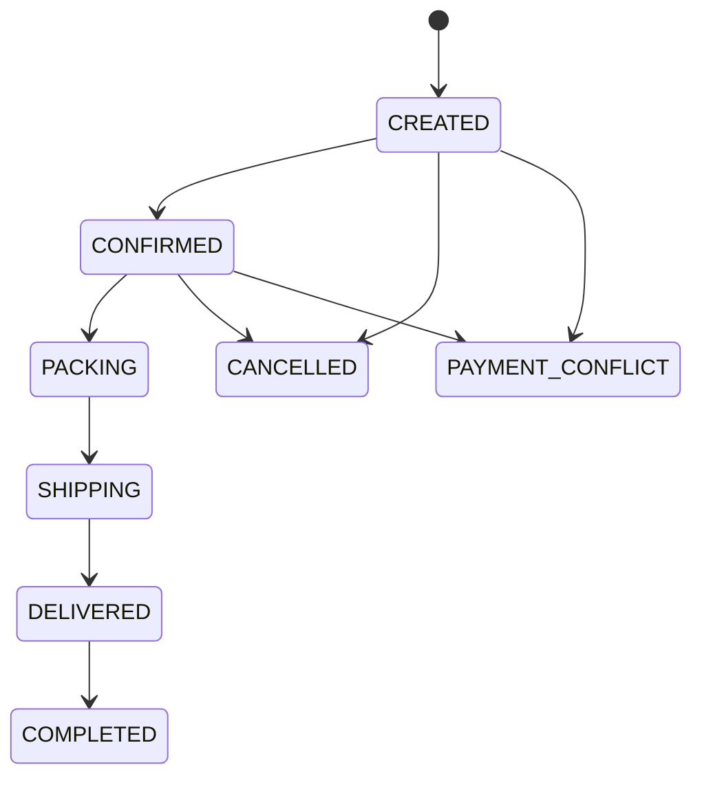

# Checkout and order architecture

## Checkout orchestration

An idempotency record binds realm, actor/cart, route, key and canonical request hash. Reusing a key with a different request is rejected.

## Phase 4B implementation boundary

The implemented modules are `IdempotencyModule`, `ReservationsModule`, `CheckoutModule`, `OrdersModule` and the provider-neutral `PaymentsModule`. `CartService.loadForCheckout()` reloads the owned cart inside the caller's MongoDB session. `InventoryService.reserveBatch()` performs conditional inventory updates and append-only ledger writes in that same session; the standalone Phase 2 reservation proof is not called by checkout.

The atomic commit contains:

1. idempotency claim;
2. authoritative cart/catalog/price reload;
3. active reservation rows and conditional inventory increments;
4. immutable order/shipping snapshots;
5. an `UNPAID` COD payment;
6. confirmed reservation references;
7. converted cart and completed idempotency result.

Preview does not reserve. The preview quote is an HMAC over current server-calculated content, so a price or cart change produces `CHECKOUT_QUOTE_CHANGED` before allocation.

## Order snapshot

Each `OrderItem` stores `productId`, `variantId`, product name, SKU, color, size, unit price, quantity, discount/tax allocation where applicable, currency and image snapshot metadata. Shipping/customer contact snapshots are separated from mutable profiles and retained according to privacy policy.

## Fulfillment state machine

Transition commands declare allowed source states, permission, side effects and audit event. Arbitrary `status` updates are forbidden.

## Payment state machine

`UNPAID → DEPOSIT_PAID → FULLY_PAID` where the selected method supports deposits.  
`DEPOSIT_PAID|FULLY_PAID → REFUND_PENDING → REFUNDED`.  
Any verified amount/reference mismatch enters `PAYMENT_CONFLICT` for review.

The frontend never declares payment success. Only verified provider callbacks or explicit server-side provider verification can transition payment state.

## Failure recovery

- Transaction failure creates no partial order/reservation.
- Provider timeout leaves a queryable pending state; retries use the same idempotency key.
- Webhooks validate signature, timestamp/replay rules, provider event ID, order reference, amount and currency before transition.

Phase 4B implements the first item and COD only. Provider timeout and webhook behavior remain Phase 4C contracts, not current runtime claims.
