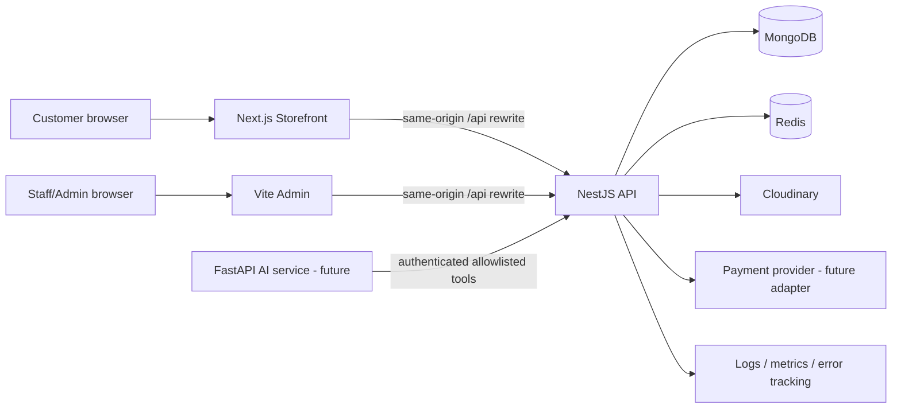

# System architecture

## Context

## Runtime responsibilities

| Component  | Owns                                                                            | Must not own                                                  |
| ---------- | ------------------------------------------------------------------------------- | ------------------------------------------------------------- |
| Storefront | SSR/RSC composition, customer UX, public metadata, same-origin API adapter      | authorization, authoritative prices, stock or payment state   |
| Admin      | operator UX, permission-aware navigation, same-origin API adapter               | authoritative RBAC or direct provider/database credentials    |
| API        | identity, authorization, validation, domain state machines, transactions, audit | arbitrary UI rendering or AI inference                        |
| MongoDB    | durable identity, commerce and audit records                                    | rate-limit counters or raw secrets                            |
| Redis      | distributed limits, short-lived coordination/cache/revocation acceleration      | durable commerce truth                                        |
| Cloudinary | media bytes and delivery transformations                                        | product/media authorization or reference integrity            |
| AI service | future inference orchestration behind controlled contracts                      | direct MongoDB/Redis access or independent mutation authority |

## Deployment model

- Storefront and admin have separate public origins.
- Each public origin routes `/api/*` to the API at the edge/reverse proxy. Browser cookies remain host-only and same-origin.
- The API may have an internal origin; direct public exposure is allowed only when the same CORS/origin and cookie controls are enforced.
- Production MongoDB and Redis are private-network services with separate least-privilege credentials.
- TLS terminates at the trusted ingress; internal TLS is required where the platform/network does not already provide an authenticated private channel.
- Development uses Docker Compose for MongoDB replica-set-capable local infrastructure and Redis; apps run natively by default.

## API conventions

- Prefix: `/api/v1`.
- Success: resource-oriented JSON; collection responses include bounded pagination metadata.
- Failure: `{ "error": { "code": "...", "message": "...", "requestId": "...", "details"?: [...] } }`.
- `Idempotency-Key` is mandatory for checkout/order creation and provider-facing mutations.
- Public DTOs are versioned contracts and are not database documents.
