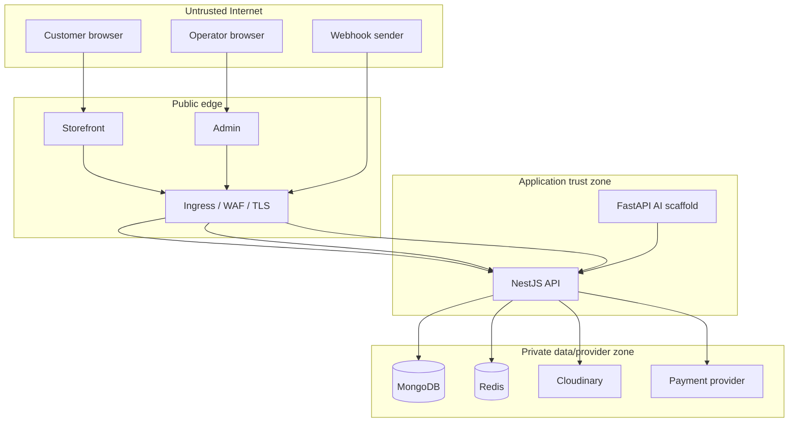

# Trust boundaries

| Boundary        | Data/authority crossing                      | Invariant                                                 | Planned enforcement                                                      |
| --------------- | -------------------------------------------- | --------------------------------------------------------- | ------------------------------------------------------------------------ |
| Browser → edge  | headers, cookies, body, identifiers, uploads | all input is hostile                                      | TLS, body limits, DTO validation, CSRF, origin checks, rate limits       |
| Customer → API  | customer session and object IDs              | customer accesses only owned/allowed resources            | customer audience/realm guard plus object policy                         |
| Operator → API  | privileged commands                          | permission and realm required for every action            | admin audience, permission guard, step-up hook, audit                    |
| API → MongoDB   | queries and mutations                        | no client query language; domain invariants remain atomic | explicit mapping, strict schemas, indexes, transactions                  |
| API → Redis     | counters and ephemeral session state         | Redis outage cannot authorize or corrupt durable state    | namespaced keys, Lua/atomic commands, bounded TTL, defined failure modes |
| API → provider  | credentials, upload/payment commands         | provider result is not trusted without verification       | scoped credentials, signed callbacks, reference checks, timeouts         |
| AI → API        | model-influenced tool arguments              | AI obtains no implicit privilege                          | service auth, tool allowlist, caller delegation, schema/RBAC/audit       |
| CI → production | artifacts and deployment authority           | build provenance and secret separation                    | locked installs, pinned actions, protected environments, least privilege |

Unknown deployment-specific resources are tracked in `open-decisions.md`; none are represented as implemented controls.
