# Customer business flows

## Guest to order

```mermaid
flowchart LR
  Visit --> Discover[Browse/search/category]
  Discover --> PDP[Product detail + variant selection]
  PDP --> Cart[Guest cart]
  Cart --> Checkout[Checkout]
  Checkout --> Identify[Sign in/register or permitted guest checkout]
  Identify --> Reprice[Server reprices and validates inventory]
  Reprice --> Reserve[Reserve inventory]
  Reserve --> Pay[Select payment method]
  Pay --> Order[Create idempotent order]
  Order --> Confirm[Confirmation and account history]
```

Guest checkout is a stakeholder decision. The architecture supports it, but Phase 0 does not enable it by default.

## Registration and onboarding

1. Client obtains a pre-auth CSRF token.
2. Customer submits email, password and allowlisted profile fields only.
3. API normalizes email, enforces uniqueness and password policy, hashes using the centralized password service, and creates `CUSTOMER` only.
4. A customer session is issued. No staff/admin role can be supplied by the request.
5. On first authenticated visit, the user sees a one-time onboarding flow using display name when available.
6. Completing or skipping onboarding stores `onboardingCompletedAt`; it is not repeated.

## Authentication and cart merge

- Email/password, Google OIDC and Sign in with Apple converge on one customer identity-linking policy.
- A guest cart is identified by a signed, high-entropy guest-cart credential, not by a client-provided user ID.
- On login the server locks both carts, revalidates variants, merges quantities subject to limits, keeps the most recent valid selections, and returns conflicts explicitly.
- Prices and inventory are recalculated; frontend totals are never authoritative.

## Account and recovery

- Profile updates expose an allowlist of fields.
- Address/order/session endpoints enforce object ownership.
- Password reset tokens are random, short-lived, one-time and stored only as hashes.
- Password change revokes other sessions by default; the current session may be preserved only after recent authentication.
- Session management lists safe device/activity metadata and supports current-session or all-session revocation.

## Order lifecycle and cancellation

- Customers can view only their own orders.
- Cancellation is accepted only from configured cancellable states and is idempotent.
- Cancellation releases active reservations and requests refund when required; it never rewrites historical order-item snapshots.
- Payment conflicts enter an operator-review state rather than being silently coerced to paid/unpaid.
