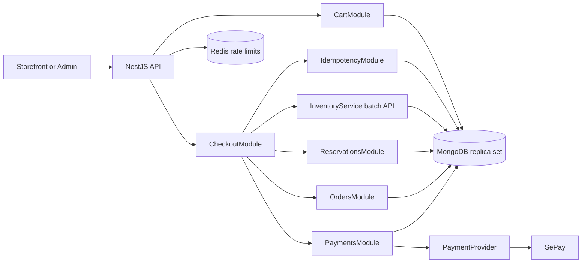

# Phase 4 transactional architecture

Date: 2026-10-06

## Boundaries

The NestJS API remains authoritative. Storefront and Admin never connect to MongoDB, Redis or SePay directly. Provider calls, email and Cloudinary work are outside database transactions.

## Collections and indexes

| Collection               | Purpose                              | Required indexes                                                                                                                                                                                |
| ------------------------ | ------------------------------------ | ----------------------------------------------------------------------------------------------------------------------------------------------------------------------------------------------- |
| `carts`                  | server-owned guest/customer items    | unique partial active `{ownerType, customerId, channel, currency}` for customer; unique partial active `{ownerType, guestCredentialDigest, channel, currency}` for guest; `{status, expiresAt}` |
| `inventory_reservations` | stock allocation lifecycle           | unique `{idempotencyIdentity, variantId}`; `{status, expiresAt}`; `{orderId, status}`; `{variantId, status}`                                                                                    |
| `idempotency_records`    | replay binding/result                | unique `{realm, ownerKey, operation, key}`; TTL `{expiresAt}` after safe retention                                                                                                              |
| `orders`                 | immutable checkout snapshots/state   | unique `orderCode`; unique `checkoutIdempotencyRecordId`; `{customerId, createdAt}`; `{status, createdAt}`; `{recipientPhoneHash, createdAt}`                                                   |
| `payments`               | provider-neutral money state         | unique `{orderId, logicalAttempt}`; unique sparse `{provider, providerTransactionId}`; unique `{provider, providerReference}`; `{status, updatedAt}`                                            |
| `payment_webhook_events` | authenticated delivery deduplication | unique `{provider, providerEventId}`; `{status, receivedAt}`; TTL only for raw/safe delivery metadata after retention approval                                                                  |

Money is integer VND. Exact internal inventory quantity is never exposed publicly.

## Transaction boundaries

### Cart mutation

One cart document update uses an optimistic `version` predicate. Merge uses one short MongoDB transaction to update target, mark source `MERGED`, and record the merge identity.

### Checkout submission

1. Claim/bind idempotency before the commerce transaction; a concurrent claimant observes `IN_PROGRESS` or the completed result.
2. In one short MongoDB transaction: load/own-check cart; revalidate catalog and prices; conditionally reserve every variant with one session; append ledger; create reservation rows; create order snapshots; create provider-neutral payment; confirm allocations; mark cart converted; complete idempotency with resource ID.
3. Commit before any provider/network action.

A transaction abort leaves no order, reservation, ledger or inventory delta. Retry uses the same idempotency record.

### Webhook/reconciliation

Verify HMAC and timestamp before parsing into domain input. In a short transaction, claim provider event ID, compare expected reference/amount/state, transition payment/order/reservation as allowed, append audit/outbox data and mark event processed. No email is sent in the transaction.

### Expiry/cancellation

Workers or commands atomically claim eligible current states, release inventory and append `RELEASE` ledger entries in the same transaction. Retrying a completed state is a no-op with the same result.

## Known foundation gap

The existing Phase 2 `InventoryService.reserve()` is retained only until the Phase 4B session-aware batch primitive replaces checkout usage. It requires a user actor, owns its transaction and lacks the Reservation aggregate; checkout must not compose it in a loop.
