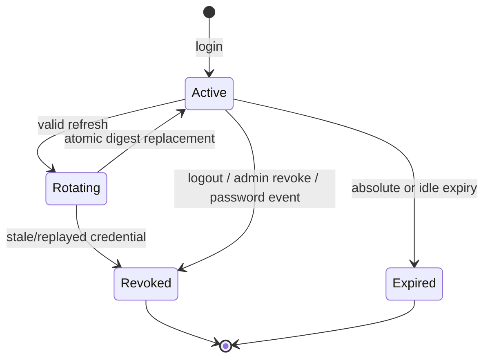

# JWT and session lifecycle

## Token choices

- Access credential: signed JWT, target TTL 5 minutes, minimal claims: `sub`, `sid`, `realm`, `rolesVersion`, `iss`, `aud`, `iat`, `exp`, `jti`.
- Refresh credential: opaque 256-bit random secret with a public session selector; it is not a long-lived self-contained JWT.
- Server storage: only a keyed SHA-256 digest of the refresh secret plus session/family metadata. Raw refresh credentials are never stored.
- Signing algorithm and key custody are deployment decisions; production must support key rotation and reject algorithm confusion.

## Cookies and same-origin routing

- Storefront/admin route browser `/api` requests through their own origin.
- Access cookies use `__Host-` names, `Secure`, `HttpOnly`, `SameSite=Lax`, `Path=/`, no `Domain`.
- Refresh cookies use realm-specific `__Secure-` names, `Secure`, `HttpOnly`, `SameSite=Strict` where OAuth/browser compatibility permits, narrow refresh route path, no `Domain`.
- CSRF token cookies are readable by the same-origin client, contain no credential, and are bound to a server-side session or signed anonymous transaction.

Exact cookie names and TTLs live in typed configuration and are tested per environment.

## Rotation

1. Parse selector and secret; reject malformed input without database operators.
2. Load the realm-bound session and verify not revoked/expired.
3. Compare keyed hash in constant time.
4. Atomically replace the expected current digest, increment rotation counter and record safe activity metadata.
5. If the expected digest no longer matches, treat it as reuse: revoke the whole token family and emit a security event.
6. Issue new access/refresh credentials only after the atomic update succeeds.

MongoDB is durable truth. Redis may cache active/revoked status but cannot resurrect a revoked session. If status cannot be established, authenticated mutations fail closed.

## CSRF

- Every cookie-authenticated unsafe method requires an allowlisted `Origin` (or strict `Referer` fallback) and a CSRF header matching a signed/bound token.
- Login, registration, password recovery initiation and OAuth linking use an anonymous pre-auth CSRF transaction.
- Webhooks do not use browser CSRF; they use provider signatures, timestamps and replay/idempotency controls.

## Logout

- Current logout atomically revokes the session, clears realm cookies and invalidates cache.
- Logout-all revokes all active sessions in the realm. Protected requests always consult session state, so previously issued access JWTs fail immediately; a separate global token-version increment is not required by the current model.
- Access tokens are checked against session status; a revoked session cannot wait out the full JWT lifetime on protected routes.
