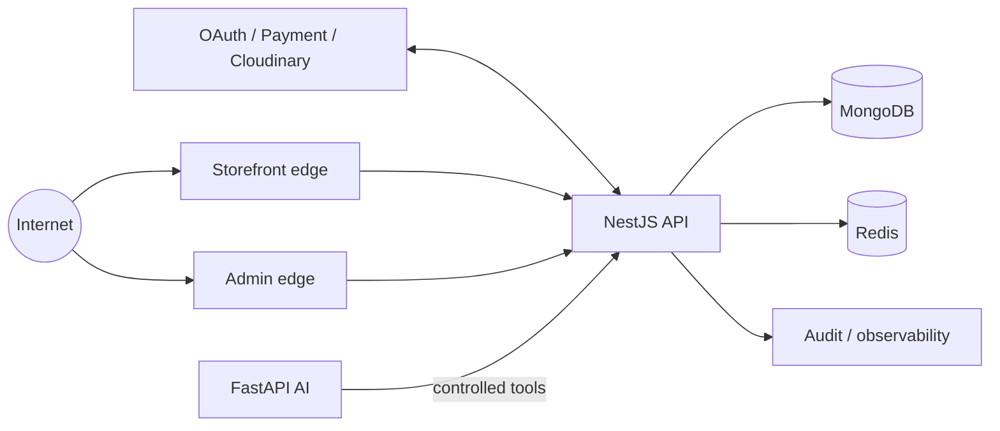

# FARTA threat model

> Status: Phase 0 design model. Scenarios are hypotheses and required review targets, not confirmed vulnerabilities. No application source or runtime existed when the initial independent architecture review was performed.

## 1. Overview

FARTA is a public fashion-commerce system with a customer storefront, a separately protected operator application, a NestJS commerce API, MongoDB, Redis, Cloudinary and a future FastAPI AI service. Browser traffic uses same-origin `/api` routing; the API owns identity, authorization and every commerce mutation. The AI service has no direct database/provider authority (`docs/architecture/system-architecture.md`).

| Component                    | Security role                                       | Evidence status                                       |
| ---------------------------- | --------------------------------------------------- | ----------------------------------------------------- |
| Storefront                   | public rendering and customer browser boundary      | planned in `docs/architecture/system-architecture.md` |
| Admin                        | separately scoped operator UI                       | planned in `docs/security/authentication.md`          |
| API                          | sole domain/authorization enforcement point         | planned in Phase 0 dossier                            |
| MongoDB                      | durable identity, commerce, session and audit truth | logical model in `docs/database/schema-design.md`     |
| Redis                        | ephemeral rate-limit/cache/coordination state       | planned; exact deployment unresolved                  |
| Cloudinary/payment providers | external privileged integrations                    | lifecycle planned; accounts/contracts unresolved      |
| AI service                   | future inference behind API tools                   | boundary accepted in ADR-010                          |

### Effective resources

| Deployment or workflow | Resource or capability               | Configuration and precedence                               | Safe effective value/location             | Readers/writers/recipients                   | Enforcing control                                            | Evidence or unknowns                         |
| ---------------------- | ------------------------------------ | ---------------------------------------------------------- | ----------------------------------------- | -------------------------------------------- | ------------------------------------------------------------ | -------------------------------------------- |
| dev/test               | MongoDB                              | typed API env over `.env`; no fallback in production       | local replica-set URI, secret outside Git | API only                                     | least-privilege credential, schema/index/transaction rules   | implementation pending                       |
| staging/prod           | MongoDB                              | deployment secret store only                               | private managed cluster reference         | API only                                     | network policy + DB identity                                 | provider/topology open                       |
| all                    | Redis                                | typed API env                                              | private Redis endpoint/key namespace      | API only                                     | ACL/TLS where supported, TTL and atomic commands             | outage policy defined per feature in Phase 2 |
| browser customer       | customer cookies                     | API typed cookie policy; production flags cannot downgrade | host-only application origin              | browser and API via same-origin edge         | Secure/HttpOnly/SameSite + CSRF + realm                      | hostnames open                               |
| browser operator       | staff cookies                        | distinct admin policy                                      | host-only admin origin                    | operator browser/API                         | distinct names/audience/realm + CSRF                         | hostnames and MFA provider open              |
| media                  | Cloudinary account and signed upload | backend secret store overrides no defaults                 | server-side credential reference only     | API/Cloudinary; short-lived client signature | scoped signing, finalize verification, reference policy      | account/formats open                         |
| payment                | SePay credentials/webhook            | backend secret store                                       | dedicated HMAC/provider secret references | API/SePay                                    | raw-body HMAC, timestamp, replay, idempotency, state machine | production account validation pending        |
| future AI              | allowlisted tool capability          | API tool registry is authoritative                         | no DB/provider credentials in AI service  | AI service → API                             | service auth + delegated user policy + audit                 | protocol/network policy open                 |
| CI/release             | build/deploy authority               | protected environment secrets                              | CI secret store; no frontend exposure     | approved workflows/deployer                  | locked install, pinned actions, least privilege              | CI provider setup pending                    |

## 2. Threat model, trust boundaries, and assumptions

### Protected assets

- customer/staff identities, passwords, OAuth identities, access/refresh/reset credentials and sessions;
- staff/admin permissions and object-level authorization guarantees;
- product/price/catalog integrity, inventory availability/ledger correctness and order/payment state;
- customer PII, addresses, purchase history and privacy/retention obligations;
- provider credentials, signing keys, database/Redis credentials and CI deployment authority;
- media integrity, audit evidence and future AI tool capability grants.

### Actors and capabilities

- Remote unauthenticated attackers can send arbitrary HTTP payloads, identifiers, headers and repeated requests; they do not start with infrastructure or secret access.
- Customers control their own browser/session inputs and can replay/change object identifiers; they must not access other customers or operator capabilities.
- `STAFF` is a partially trusted actor with explicit assigned permissions; it is not equivalent to `ADMIN`/`OWNER`.
- A cross-site attacker may cause browser requests when cookies attach; CSRF defenses must not depend only on SameSite.
- Uploaders can control bytes/metadata within exposed upload flows; direct remote fetch and SVG remain disabled initially.
- Future model/user input can influence AI-proposed tool arguments but grants no authority by itself.
- Providers and webhooks are external trust boundaries; correct URL alone is never authenticity.

### Security objectives

1. Default-deny realm, permission, ownership and state-transition checks on every protected operation.
2. Atomic refresh rotation/reuse detection and immediate server-session revocation.
3. Explicit input/output allowlists; no client Mongo query/update language or mass assignment.
4. Atomic, auditable inventory/reservation/order/payment operations with idempotency.
5. Strong browser controls: host-only secure cookies, CSRF, safe redirects, encoding and practical CSP.
6. Scoped provider calls, signed/replay-protected callbacks, timeouts and bounded external data.
7. No credentials or PII in frontend bundles, public errors, logs or audit summaries.
8. AI remains outside data/provider trust zones and cannot bypass the same API policies as humans.

### Assumptions and unknowns

- The initial model is design-backed, not implementation-backed; controls must be re-evaluated at Phase 2 and before production.
- Production/staging hosts, cloud/network layout, JWT key service, payment business values, retention and incident tooling are open decisions (`docs/architecture/open-decisions.md`). SePay is the selected Phase 4 online provider, but production account/credential validation remains external evidence.
- MongoDB replica-set transactions are a deployment prerequisite for multi-document commerce invariants.
- The edge must preserve trusted origin/host/client-IP semantics; the API trusts forwarding headers only from configured proxies.
- Customer-supplied rich HTML, SVG upload, remote URL import and direct AI database access are excluded from the initial product.

## 3. Attack surface, mitigations, and attacker stories

| Priority            | Scenario and capability gain                                                    | Prerequisites                                          | Impact                                         | Existing controls                                    | Required mitigation/evidence                                            |
| ------------------- | ------------------------------------------------------------------------------- | ------------------------------------------------------ | ---------------------------------------------- | ---------------------------------------------------- | ----------------------------------------------------------------------- |
| Critical hypothesis | forged payment/admin command changes order, money or role state                 | reachable endpoint plus missing auth/signature/policy  | financial loss or full administrative takeover | planned realm/RBAC/payment boundary                  | E2E negative tests, provider contract and audit evidence                |
| Critical hypothesis | inventory race oversells scarce stock                                           | concurrent checkout with non-atomic update             | financial/operational integrity loss           | ADR-006 design                                       | real Mongo 100-way concurrency proof                                    |
| High hypothesis     | IDOR exposes/modifies another customer's order/session/address                  | authenticated customer can alter identifier            | PII disclosure or unauthorized mutation        | object-policy design                                 | representative read/write/cancel E2E tests                              |
| High hypothesis     | refresh replay keeps attacker access                                            | stolen prior token plus weak rotation                  | durable account/admin session compromise       | atomic family-revoke design                          | concurrent rotation/replay tests and session-state check                |
| High hypothesis     | customer token accepted by admin realm                                          | shared audience/guard/cookie namespace                 | vertical privilege escalation                  | ADR-001 separation                                   | cross-realm rejection tests on every admin guard composition            |
| High hypothesis     | NoSQL/mass-assignment payload bypasses login or assigns role                    | raw body/filter/update reaches Mongoose                | auth bypass/privilege escalation               | DTO + explicit mapping design                        | recursive operator/pollution/property regression suite                  |
| High hypothesis     | CSRF triggers authenticated mutation                                            | cookie auth and missing origin/token enforcement       | order/profile/admin mutation                   | ADR-003 design                                       | pre-auth and authenticated cross-origin tests                           |
| High hypothesis     | malicious upload/remote media reaches active-content or internal fetch sink     | enabled upload/fetch path                              | stored XSS, malware or SSRF                    | direct signed image-only flow, remote fetch disabled | signature/MIME/size tests and provider delivery review                  |
| High hypothesis     | AI prompt induces privileged tool call                                          | AI feature active with weak delegation                 | commerce/admin mutation beyond user authority  | ADR-010 boundary                                     | tool allowlist, per-call user policy/idempotency/audit tests            |
| Medium hypothesis   | XSS in product/banner/customer content steals non-HttpOnly data or acts as user | unsafe rich rendering/CSP gap                          | session actions/data exposure                  | structured content and React escaping planned        | sink inventory, sanitizer tests if rich text appears, CSP browser test  |
| Medium hypothesis   | rate-limit bypass enables credential guessing/resource abuse                    | spoofed client IP or per-replica memory limiter        | account compromise/availability cost           | Redis policy groups planned                          | trusted-proxy tests, distributed counters and fail-mode tests           |
| High hypothesis     | forged/stale SePay webhook or amount mismatch marks an order paid               | exposed endpoint plus failed HMAC/reference validation | financial loss and inventory inconsistency     | ADR-018 raw-body HMAC/timestamp/conflict design      | invalid/stale/signature/amount/reference E2E tests and sandbox evidence |
| Medium hypothesis   | duplicate checkout/webhook creates duplicate order/payment transition           | retries/reordered provider events                      | financial/data inconsistency                   | idempotency/state machines planned                   | same-key/same-hash and conflicting-hash concurrency tests               |
| Medium hypothesis   | verbose errors/logs expose secrets or PII                                       | exception/provider failures                            | secondary compromise/privacy harm              | error/redaction design                               | log capture and production error leakage assertions                     |
| Low/conditional     | path traversal writes/reads server files                                        | future local file handling uses filenames              | local data exposure/modification               | no local file feature planned                        | generated IDs/fixed roots; test when feature exists                     |

These rows are review hypotheses. Until code exists, neither the presence nor absence of a vulnerability is established.

## 4. Severity calibration

- **Critical:** unauthenticated or low-privilege path to `OWNER`/deployment authority, arbitrary authoritative payment mutation, or systemic inventory/order corruption with realistic production exposure. Not critical when it requires pre-existing owner/CI/secret control.
- **High:** cross-account object access, staff privilege escalation, durable session takeover, verified webhook forgery, sensitive SSRF, or stored script execution in admin context. Effective step-up, network isolation or non-reachability can lower likelihood but must be proven.
- **Medium:** bounded account-specific CSRF, rate-limit bypass without demonstrated account compromise, non-sensitive internal disclosure, or duplicate workflow recoverable without financial loss.
- **Low:** limited self-only effects or hardening gaps with no meaningful privilege/data/integrity gain. Missing implementation evidence is an unknown, not automatically a finding.

Severity and confidence are separate: a critical-impact design hypothesis can remain low-confidence until reachability and failed controls are demonstrated.

Repository: sha256:1458dd452a1c2eafedb95b35508fe3c2bcdaf994c412043ec9e5ac33ac07ef20
Version: codex-security-snapshot/v1:sha256:f8302f2ec681a3220229cc3e053658b9b5a33ad5d50d318c9cba8f9c41a98333
